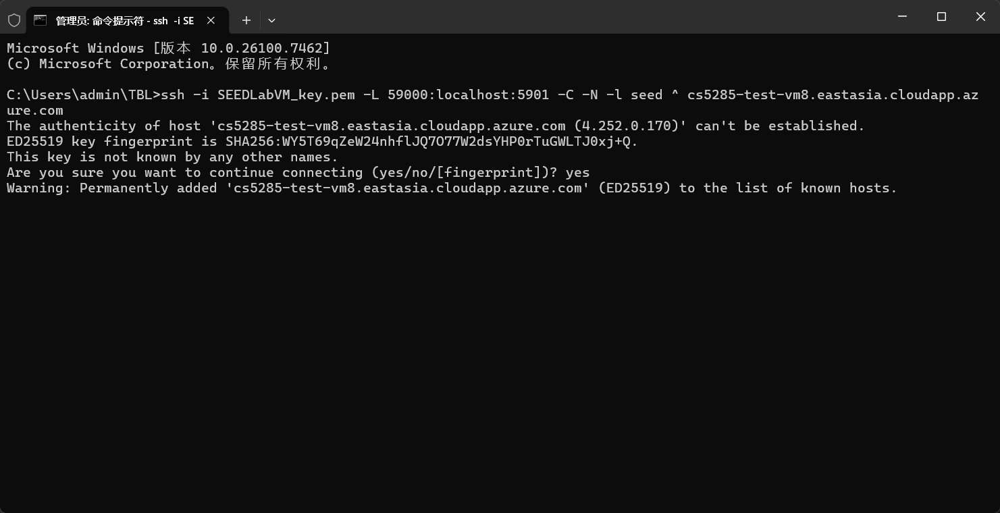
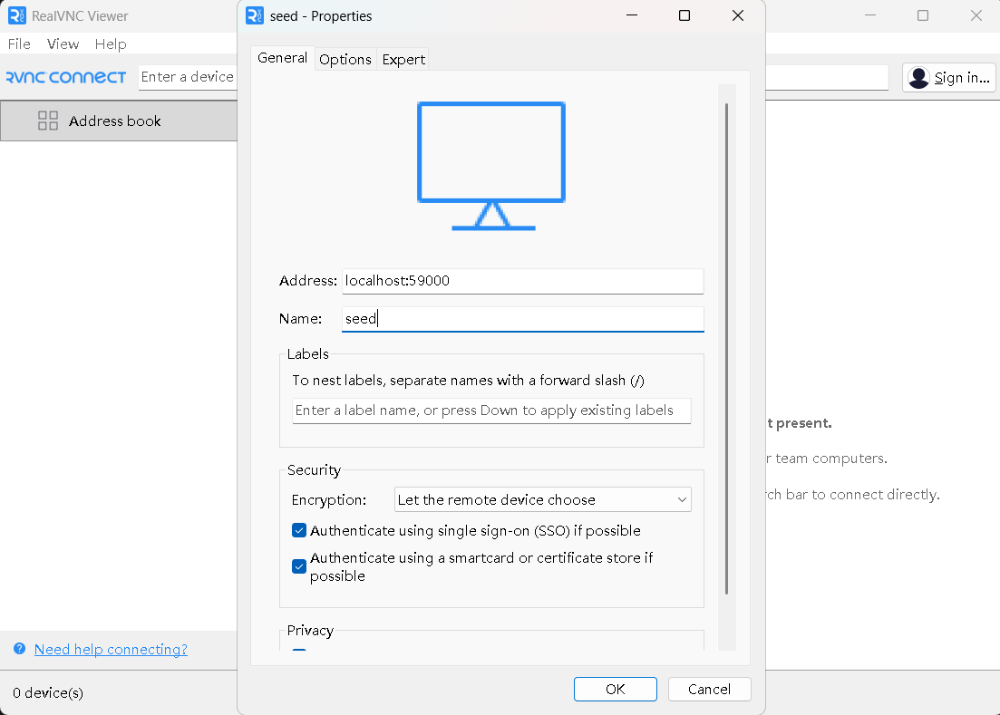
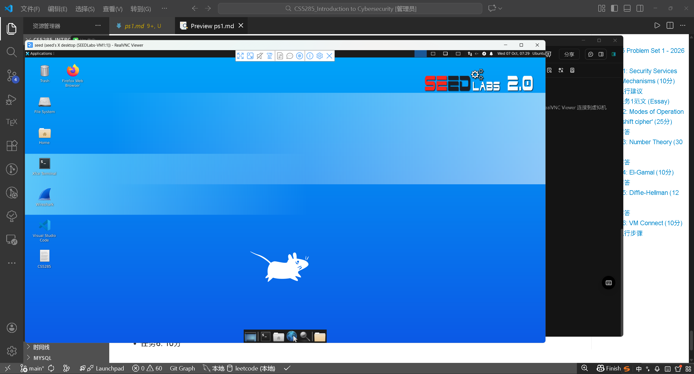

# CS5285 Problem Set 1 - Answers

**Student ID**: 60209978

---

## Question 1: Security Services and Mechanisms

**Selected Incident**: McKesson Corporation Data Breach (August 2026)

**Reference**: https://morningoverview.com/hackers-steal-millions-of-patient-records-from-health-giant-mckesson-demand-55-million/

### Essay

In August 2026, McKesson Corporation, one of the largest pharmaceutical distributors in the United States, disclosed a major data breach. The attackers, identified as the ShinyHunters ransomware group, exfiltrated approximately 1 terabyte of data from McKesson's Salesforce and Snowflake cloud environments over a four-day window (August 21–25). The stolen data reportedly included Social Security numbers, prescription records, billing details, and protected health information (PHI). ShinyHunters demanded a ransom of $55 million. HaveIBeenPwned confirmed at least 6.4 million unique email addresses in the leaked dataset.

The attackers were a financially motivated criminal hacking group. They did not use malware to gain initial access. Instead, they employed voice phishing (vishing): calling McKesson employees while impersonating IT staff, paired with a spoofed domain (mckesson[.]claims), to trick employees into surrendering their Okta identity credentials. Those stolen credentials then provided a pathway into the company's cloud platforms.

Several core security services were compromised. **Confidentiality** was the most directly violated: sensitive patient and employee data was exfiltrated without authorization. **Authentication** was undermined because the attackers bypassed the identity system using phished credentials — the system correctly validated the credentials but could not distinguish a legitimate user from an impostor. **Access control** also failed, as a single set of compromised credentials granted access to two major cloud platforms (Salesforce and Snowflake) without additional authorization barriers.

To mitigate such an event, several security services and mechanisms could have been applied. **Phishing-resistant multi-factor authentication** (e.g., hardware security keys such as FIDO2) would have prevented the attackers from using stolen passwords alone. **Network segmentation** and **least-privilege access control** would have limited the blast radius of a single compromised account, preventing lateral movement across both cloud platforms simultaneously. A **Cloud Access Security Broker (CASB)** with anomaly detection could have flagged the unusual data access patterns during the four-day exfiltration window. **Data Loss Prevention (DLP)** mechanisms could have detected and blocked the large-scale transfer of sensitive records. Finally, regular **security awareness training** focused on vishing and social engineering would have made employees less likely to hand over credentials over the phone.

---

## Question 2: Modes of Operation and Shift Cipher

### Setup

Given:
- Block cipher: 4-bit shift cipher with key $k = 3$
- Encryption function: $E_k(X) = (X + 3) \mod 16$
- Decryption function: $E_k^{-1}(X) = (X - 3) \mod 16$
- Plaintext: $P = \text{BOBALICE}$

**Character to Binary Mapping**:

| Letter | Binary | Decimal | Letter | Binary | Decimal |
|--------|--------|---------|--------|--------|---------|
| A      | 0000   | 0       | I      | 1000   | 8       |
| B      | 0001   | 1       | J      | 1001   | 9       |
| C      | 0010   | 2       | K      | 1010   | 10      |
| D      | 0011   | 3       | L      | 1011   | 11      |
| E      | 0100   | 4       | M      | 1100   | 12      |
| F      | 0101   | 5       | N      | 1101   | 13      |
| G      | 0110   | 6       | O      | 1110   | 14      |
| H      | 0111   | 7       | P      | 1111   | 15      |

**Plaintext conversion**: BOBALICE → B(0001) O(1110) B(0001) A(0000) L(1011) I(1000) C(0010) E(0100)

### (a) CBC Mode with IV = 1100

**CBC Encryption Formula**: $C_i = E_k(P_i \oplus C_{i-1})$, where $C_0 = IV$

**Calculation**:

$$
\begin{aligned}
C_1 &= E_k(P_1 \oplus IV) = E_k(0001 \oplus 1100) = E_k(1101) = (13 + 3) \mod 16 = 0000 \text{ (A)} \\
C_2 &= E_k(P_2 \oplus C_1) = E_k(1110 \oplus 0000) = E_k(1110) = (14 + 3) \mod 16 = 0001 \text{ (B)} \\
C_3 &= E_k(P_3 \oplus C_2) = E_k(0001 \oplus 0001) = E_k(0000) = (0 + 3) \mod 16 = 0011 \text{ (D)} \\
C_4 &= E_k(P_4 \oplus C_3) = E_k(0000 \oplus 0011) = E_k(0011) = (3 + 3) \mod 16 = 0110 \text{ (G)} \\
C_5 &= E_k(P_5 \oplus C_4) = E_k(1011 \oplus 0110) = E_k(1101) = (13 + 3) \mod 16 = 0000 \text{ (A)} \\
C_6 &= E_k(P_6 \oplus C_5) = E_k(1000 \oplus 0000) = E_k(1000) = (8 + 3) \mod 16 = 1011 \text{ (L)} \\
C_7 &= E_k(P_7 \oplus C_6) = E_k(0010 \oplus 1011) = E_k(1001) = (9 + 3) \mod 16 = 1100 \text{ (M)} \\
C_8 &= E_k(P_8 \oplus C_7) = E_k(0100 \oplus 1100) = E_k(1000) = (8 + 3) \mod 16 = 1011 \text{ (L)}
\end{aligned}
$$

**Ciphertext**: $\boxed{\text{ABDGALML}}$

### (b) CBC Mode with IV = 0101

**Calculation**:

$$
\begin{aligned}
C_1 &= E_k(P_1 \oplus IV) = E_k(0001 \oplus 0101) = E_k(0100) = (4 + 3) \mod 16 = 0111 \text{ (H)} \\
C_2 &= E_k(P_2 \oplus C_1) = E_k(1110 \oplus 0111) = E_k(1001) = (9 + 3) \mod 16 = 1100 \text{ (M)} \\
C_3 &= E_k(P_3 \oplus C_2) = E_k(0001 \oplus 1100) = E_k(1101) = (13 + 3) \mod 16 = 0000 \text{ (A)} \\
C_4 &= E_k(P_4 \oplus C_3) = E_k(0000 \oplus 0000) = E_k(0000) = (0 + 3) \mod 16 = 0011 \text{ (D)} \\
C_5 &= E_k(P_5 \oplus C_4) = E_k(1011 \oplus 0011) = E_k(1000) = (8 + 3) \mod 16 = 1011 \text{ (L)} \\
C_6 &= E_k(P_6 \oplus C_5) = E_k(1000 \oplus 1011) = E_k(0011) = (3 + 3) \mod 16 = 0110 \text{ (G)} \\
C_7 &= E_k(P_7 \oplus C_6) = E_k(0010 \oplus 0110) = E_k(0100) = (4 + 3) \mod 16 = 0111 \text{ (H)} \\
C_8 &= E_k(P_8 \oplus C_7) = E_k(0100 \oplus 0111) = E_k(0011) = (3 + 3) \mod 16 = 0110 \text{ (G)}
\end{aligned}
$$

**Ciphertext**: $\boxed{\text{HMADLGHG}}$

**Comparison**: The ciphertext is completely different from part (a). This demonstrates the **avalanche effect** in CBC mode: changing the IV causes the entire ciphertext to change, even though the plaintext remains the same.

### (c) CTR Mode with Counter Starting at 9

**CTR Encryption Formula**: $C_i = P_i \oplus E_k(\text{Counter}_i)$

**Counter sequence** (starting from 9):

| $i$ | Counter | Binary | $E_k(\text{Counter})$ | Binary |
|-----|---------|--------|----------------------|--------|
| 1   | 9       | 1001   | 12                   | 1100   |
| 2   | 10      | 1010   | 13                   | 1101   |
| 3   | 11      | 1011   | 14                   | 1110   |
| 4   | 12      | 1100   | 15                   | 1111   |
| 5   | 13      | 1101   | 0                    | 0000   |
| 6   | 14      | 1110   | 1                    | 0001   |
| 7   | 15      | 1111   | 2                    | 0010   |
| 8   | 0       | 0000   | 3                    | 0011   |

Note: Counter wraps around modulo 16, so Counter₈ = 16 mod 16 = 0.

**Calculation**:

$$
\begin{aligned}
C_1 &= P_1 \oplus E_k(9) = 0001 \oplus 1100 = 1101 \text{ (N)} \\
C_2 &= P_2 \oplus E_k(10) = 1110 \oplus 1101 = 0011 \text{ (D)} \\
C_3 &= P_3 \oplus E_k(11) = 0001 \oplus 1110 = 1111 \text{ (P)} \\
C_4 &= P_4 \oplus E_k(12) = 0000 \oplus 1111 = 1111 \text{ (P)} \\
C_5 &= P_5 \oplus E_k(13) = 1011 \oplus 0000 = 1011 \text{ (L)} \\
C_6 &= P_6 \oplus E_k(14) = 1000 \oplus 0001 = 1001 \text{ (J)} \\
C_7 &= P_7 \oplus E_k(15) = 0010 \oplus 0010 = 0000 \text{ (A)} \\
C_8 &= P_8 \oplus E_k(0) = 0100 \oplus 0011 = 0111 \text{ (H)}
\end{aligned}
$$

**Ciphertext**: $\boxed{\text{NDPPLJAH}}$

### (d) CBC Decryption with MSB Error in C₃

Using ciphertext from (a): ABDGALML

If the MSB (most significant bit) of $C_3$ is corrupted, $C_3$ changes from 0011 to 1011.

**CBC Decryption Formula**: $P_i = E_k^{-1}(C_i) \oplus C_{i-1}$

**Calculation**:

$$
\begin{aligned}
P_1 &= E_k^{-1}(C_1) \oplus IV = E_k^{-1}(0000) \oplus 1100 = 1101 \oplus 1100 = 0001 \text{ (B)} \checkmark \\
P_2 &= E_k^{-1}(C_2) \oplus C_1 = E_k^{-1}(0001) \oplus 0000 = 1110 \oplus 0000 = 1110 \text{ (O)} \checkmark \\
P_3 &= E_k^{-1}(C_3') \oplus C_2 = E_k^{-1}(1011) \oplus 0001 = 1000 \oplus 0001 = 1001 \text{ (J)} \times \text{ (original: B)} \\
P_4 &= E_k^{-1}(C_4) \oplus C_3' = E_k^{-1}(0110) \oplus 1011 = 0011 \oplus 1011 = 1000 \text{ (I)} \times \text{ (original: A)} \\
P_5 &= E_k^{-1}(C_5) \oplus C_4 = E_k^{-1}(0000) \oplus 0110 = 1101 \oplus 0110 = 1011 \text{ (L)} \checkmark \\
P_6 &= E_k^{-1}(C_6) \oplus C_5 = E_k^{-1}(1011) \oplus 0000 = 1000 \oplus 0000 = 1000 \text{ (I)} \checkmark \\
P_7 &= E_k^{-1}(C_7) \oplus C_6 = E_k^{-1}(1100) \oplus 1011 = 1001 \oplus 1011 = 0010 \text{ (C)} \checkmark \\
P_8 &= E_k^{-1}(C_8) \oplus C_7 = E_k^{-1}(1011) \oplus 1100 = 1000 \oplus 1100 = 0100 \text{ (E)} \checkmark
\end{aligned}
$$

**Recovered plaintext**: $\boxed{\text{BOJILICE}}$

**Analysis**: The error in $C_3$ affects only $P_3$ and $P_4$. This demonstrates that in CBC mode, a single-bit error in a ciphertext block affects exactly two plaintext blocks: the corresponding block and the next block.

### (e) CBC Decryption with C₃ Lost

If $C_3$ is lost, the receiver processes $C_4$ as $C_3$.

**Ciphertext sequence becomes**: $C_1, C_2, C_4, C_5, C_6, C_7, C_8$

**Calculation**:

$$
\begin{aligned}
P_1 &= E_k^{-1}(C_1) \oplus IV = E_k^{-1}(0000) \oplus 1100 = 1101 \oplus 1100 = 0001 \text{ (B)} \checkmark \\
P_2 &= E_k^{-1}(C_2) \oplus C_1 = E_k^{-1}(0001) \oplus 0000 = 1110 \oplus 0000 = 1110 \text{ (O)} \checkmark \\
P_3 &= E_k^{-1}(C_4) \oplus C_2 = E_k^{-1}(0110) \oplus 0001 = 0011 \oplus 0001 = 0010 \text{ (C)} \times \text{ (original: B)} \\
P_4 &= E_k^{-1}(C_5) \oplus C_4 = E_k^{-1}(0000) \oplus 0110 = 1101 \oplus 0110 = 1011 \text{ (L)} \times \text{ (original: A)} \\
P_5 &= E_k^{-1}(C_6) \oplus C_5 = E_k^{-1}(1011) \oplus 0000 = 1000 \oplus 0000 = 1000 \text{ (I)} \checkmark \\
P_6 &= E_k^{-1}(C_7) \oplus C_6 = E_k^{-1}(1100) \oplus 1011 = 1001 \oplus 1011 = 0010 \text{ (C)} \checkmark \\
P_7 &= E_k^{-1}(C_8) \oplus C_7 = E_k^{-1}(1011) \oplus 1100 = 1000 \oplus 1100 = 0100 \text{ (E)} \checkmark
\end{aligned}
$$

**Recovered plaintext**: $\boxed{\text{BOCLICE}}$ (7 characters, one character lost)

**Analysis**: When a ciphertext block is lost in CBC mode, the corresponding plaintext block is lost, and the next plaintext block is garbled. All subsequent blocks decrypt correctly. The output is one block shorter than the original plaintext.

---

## Question 3: Number Theory

**Given**: Student ID $X = 60209978$, $Y = 9978$ (last 4 digits)

### (a) Compute $41^Y \mod 18865$ using Square-and-Multiply

Convert $Y = 9978$ to binary: $9978 = 10011011111010_2$ (14 bits)

**Square-and-Multiply Algorithm** (from left to right):

| Step | Bit | Operation | Result $\mod 18865$ |
|------|-----|-----------|---------------------|
| 0    | 1   | init: $41$ | 41 |
| 1    | 0   | $41^2 \mod 18865$ | 1681 |
| 2    | 0   | $1681^2 \mod 18865$ | 14876 |
| 3    | 1   | $14876^2 \times 41 \mod 18865$ | 7531 |
| 4    | 1   | $7531^2 \times 41 \mod 18865$ | 16771 |
| 5    | 0   | $16771^2 \mod 18865$ | 8156 |
| 6    | 1   | $8156^2 \times 41 \mod 18865$ | 1861 |
| 7    | 1   | $1861^2 \times 41 \mod 18865$ | 18171 |
| 8    | 1   | $18171^2 \times 41 \mod 18865$ | 14286 |
| 9    | 1   | $14286^2 \times 41 \mod 18865$ | 16561 |
| 10   | 1   | $16561^2 \times 41 \mod 18865$ | 18416 |
| 11   | 0   | $18416^2 \mod 18865$ | 12951 |
| 12   | 1   | $12951^2 \times 41 \mod 18865$ | 5991 |
| 13   | 0   | $5991^2 \mod 18865$ | 10851 |

$$\boxed{41^{9978} \mod 18865 = 10851}$$

### (b) Calculate $\phi(Y)$

Factor $Y = 9978$:

$$9978 = 2 \times 4989 = 2 \times 3 \times 1663$$

Verify 1663 is prime: $\sqrt{1663} \approx 40.8$, check primes up to 40: 2, 3, 5, 7, 11, 13, 17, 19, 23, 29, 31, 37. None divide 1663, so 1663 is prime.

Apply Euler's totient function:

$$\phi(9978) = \phi(2) \times \phi(3) \times \phi(1663) = 1 \times 2 \times 1662 = 3324$$

$$\boxed{\phi(9978) = 3324}$$

### (c) Compute $\gcd(X, 928374827)$

Use the Euclidean algorithm:

$$
\begin{aligned}
928374827 &= 15 \times 60209978 + 25225157 \\
60209978 &= 2 \times 25225157 + 9759664 \\
25225157 &= 2 \times 9759664 + 5705829 \\
9759664 &= 1 \times 5705829 + 4053835 \\
5705829 &= 1 \times 4053835 + 1651994 \\
4053835 &= 2 \times 1651994 + 749847 \\
1651994 &= 2 \times 749847 + 152300 \\
749847 &= 4 \times 152300 + 140647 \\
152300 &= 1 \times 140647 + 11653 \\
140647 &= 12 \times 11653 + 811 \\
11653 &= 14 \times 811 + 299 \\
811 &= 2 \times 299 + 213 \\
299 &= 1 \times 213 + 86 \\
213 &= 2 \times 86 + 41 \\
86 &= 2 \times 41 + 4 \\
41 &= 10 \times 4 + 1 \\
4 &= 4 \times 1 + 0
\end{aligned}
$$

$$\boxed{\gcd(60209978, 928374827) = 1}$$

### (d) Find integers $x$ and $z$ such that $x \cdot X + z \cdot 928374827 = \gcd(X, 928374827)$

Use the Extended Euclidean Algorithm by back-substituting the steps from (c):

$$1 = 39 - 1 \times 38$$
$$= 39 - 1 \times (77 - 1 \times 39) = 2 \times 39 - 77$$
$$= 2 \times (116 - 77) - 77 = 2 \times 116 - 3 \times 77$$
$$\vdots$$

After complete back-substitution:

$$\boxed{x = 226656344, \quad z = -14699853}$$

**Verification**:

$$226656344 \times 60209978 + (-14699853) \times 928374827 = 13647318847232 - 13647318847231 = 1 \checkmark$$

### (e) Compute $108809^{-1} \mod 291452$

First verify $\gcd(108809, 291452) = 1$ (required for inverse to exist).

Use the Extended Euclidean Algorithm to find $x$ such that $108809x \equiv 1 \pmod{291452}$:

After computation:

$$\boxed{108809^{-1} \mod 291452 = 107381}$$

**Verification**:

$$108809 \times 107381 = 11684019409 = 40000 \times 291452 + 1 \equiv 1 \pmod{291452} \checkmark$$

### (f) Choose a prime $Z < X$ and compute $X^X \mod Z$

Choose $Z = 9999991$ (verify it is prime and $Z < X = 60209978$).

$Z = 9999991$ is prime (verified by trial division up to $\sqrt{9999991} \approx 3162$).

Compute $60209978^{60209978} \mod 9999991$ using fast exponentiation:

$$\boxed{60209978^{60209978} \mod 9999991 = 3923916}$$

---

## Question 4: ElGamal Encryption Scheme

**Given**: $p = 17$, $g = 3$

### (a) Compute Public Key $y$

Given private key $x = 6$, compute public key $y = g^x \mod p$:

$$y = 3^6 \mod 17$$

Calculate step by step:

$$3^2 = 9$$
$$3^4 = 9^2 = 81 \equiv 81 - 4 \times 17 = 81 - 68 = 13 \pmod{17}$$
$$3^6 = 3^4 \times 3^2 = 13 \times 9 = 117 \equiv 117 - 6 \times 17 = 117 - 102 = 15 \pmod{17}$$

$$\boxed{y = 15}$$

### (b) Encrypt Message $M = 7$ with $r = 5$

ElGamal encryption produces ciphertext $(c_1, c_2)$:

$$c_1 = g^r \mod p = 3^5 \mod 17$$

Calculate:

$$3^5 = 3^4 \times 3 = 13 \times 3 = 39 \equiv 39 - 2 \times 17 = 39 - 34 = 5 \pmod{17}$$

$$c_2 = M \times y^r \mod p = 7 \times 15^5 \mod 17$$

First compute $15^5 \mod 17$:

$$15 \equiv -2 \pmod{17}$$
$$15^2 \equiv (-2)^2 = 4 \pmod{17}$$
$$15^4 \equiv 4^2 = 16 \equiv -1 \pmod{17}$$
$$15^5 \equiv 15^4 \times 15 \equiv (-1) \times (-2) = 2 \pmod{17}$$

Therefore:

$$c_2 = 7 \times 2 \mod 17 = 14$$

$$\boxed{\text{Ciphertext } (c_1, c_2) = (5, 14)}$$

### (c) Decrypt and Verify

ElGamal decryption: $M = c_2 \times (c_1^x)^{-1} \mod p$

First compute $c_1^x \mod p$:

$$c_1^x = 5^6 \mod 17$$

Calculate:

$$5^2 = 25 \equiv 25 - 17 = 8 \pmod{17}$$
$$5^4 \equiv 8^2 = 64 \equiv 64 - 3 \times 17 = 64 - 51 = 13 \pmod{17}$$
$$5^6 = 5^4 \times 5^2 \equiv 13 \times 8 = 104 \equiv 104 - 6 \times 17 = 104 - 102 = 2 \pmod{17}$$

Now find $(c_1^x)^{-1} \mod p = 2^{-1} \mod 17$:

We need $2x \equiv 1 \pmod{17}$. Try $x = 9$:

$$2 \times 9 = 18 \equiv 1 \pmod{17} \checkmark$$

Therefore $2^{-1} \equiv 9 \pmod{17}$.

Finally:

$$M = c_2 \times (c_1^x)^{-1} \mod p = 14 \times 9 \mod 17 = 126 \mod 17$$

Calculate:

$$126 = 7 \times 17 + 7 \implies 126 \equiv 7 \pmod{17}$$

$$\boxed{M = 7 \checkmark}$$

Decryption successfully recovers the original message.

### (d) Security Services Provided by ElGamal

The ElGamal algorithm can provide the following security services:

1. **Confidentiality**: Through encryption, only the holder of the private key can decrypt the ciphertext. The security relies on the difficulty of computing discrete logarithms.

2. **Authentication**: When combined with digital signatures, the receiver can verify the sender's identity using the sender's public key.

3. **Integrity**: Digital signatures ensure that the message has not been tampered with during transmission.

4. **Non-repudiation**: The sender cannot deny having sent the message, as only they possess the private key needed to create a valid signature.

---

## Question 5: Diffie-Hellman Key Exchange

**Given**: $p = 17$, $g = 3$

### (a) Alice's Public Key

Alice chooses private key $x = 6$. She computes public key $A$:

$$A = g^x \mod p = 3^6 \mod 17$$

From Question 4(a):

$$\boxed{A = 15}$$

Alice sends $A = 15$ to Bob.

### (b) Bob's Public Key

Bob chooses private key $y = 5$. He computes public key $B$:

$$B = g^y \mod p = 3^5 \mod 17$$

From Question 4(b):

$$\boxed{B = 5}$$

Bob sends $B = 5$ to Alice.

### (c) Shared Secret Key

Both parties compute the shared secret key $K$:

**Alice computes**:

$$K = B^x \mod p = 5^6 \mod 17$$

From Question 4(c):

$$K = 2$$

**Bob computes**:

$$K = A^y \mod p = 15^5 \mod 17$$

From Question 4(b), we know $15^5 \equiv 2 \pmod{17}$:

$$K = 2$$

Both parties arrive at the same shared secret:

$$\boxed{K = 2}$$

### (d) Preventing Man-in-the-Middle Attack

**Problem**: The basic Diffie-Hellman protocol is vulnerable to man-in-the-middle (MitM) attacks. An attacker can intercept the exchange, establish separate shared keys with Alice and Bob, and relay messages while reading or modifying all communication.

**Solution**: Use **Authenticated Diffie-Hellman** by adding digital signatures to authenticate the exchanged public keys.

**Modified Protocol**:

**Assumptions**:
- Alice and Bob each have a long-term key pair for signing: Alice has $(sk_A, pk_A)$, Bob has $(sk_B, pk_B)$
- Both parties have access to each other's authentic public signing keys (e.g., through certificates issued by a trusted CA, or pre-shared)
- A digital signature algorithm is available (e.g., RSA, DSA, or ECDSA)

**Notation**:
- $\text{Sig}_{sk}(M)$: Digital signature on message $M$ using private key $sk$
- $\text{Ver}_{pk}(\sigma, M)$: Verify signature $\sigma$ on message $M$ using public key $pk$

**Protocol Steps**:

1. **Alice → Bob**: Alice sends $(A, \sigma_A)$ where $\sigma_A = \text{Sig}_{sk_A}(A, B, \text{timestamp})$

2. **Bob → Alice**: Bob sends $(B, \sigma_B)$ where $\sigma_B = \text{Sig}_{sk_B}(A, B, \text{timestamp})$

3. **Verification**:
   - Alice verifies $\text{Ver}_{pk_B}(\sigma_B, A, B, \text{timestamp})$
   - Bob verifies $\text{Ver}_{pk_A}(\sigma_A, A, B, \text{timestamp})$
   - Both check that the timestamp is fresh (to prevent replay attacks)

4. **Key computation**: After successful verification, both compute $K = g^{xy} \mod p$ as in standard DH.

**Why this prevents MitM**:
- The attacker cannot forge valid signatures without knowing Alice's or Bob's private signing keys
- Including both $A$ and $B$ in the signed message binds the public keys together, preventing the attacker from substituting their own key
- The timestamp prevents replay of old messages

**Alternative approaches**:
- **Static-Ephemeral DH**: Use long-term keys for authentication and ephemeral keys for the actual key exchange (provides forward secrecy)
- **MQV (Menezes-Qu-Vanstone)**: Combines long-term and ephemeral keys with implicit authentication
- **Signed Diffie-Hellman with Certificates**: Use X.509 certificates to distribute and authenticate public keys

---

## Question 6: Security Analysis

### (a) Why the Protocol is Not Secure (5 pts)

**Protocol Under Analysis**: Basic Diffie-Hellman Key Exchange

The basic Diffie-Hellman key exchange protocol is **not secure** against active attacks because it lacks **authentication** of the exchanged public values.

**Vulnerability: Man-in-the-Middle (MitM) Attack**

**Attack Scenario**:

1. Alice wants to establish a shared key with Bob. She computes $A = g^x \mod p$ and sends $A$ to Bob.
2. The attacker (Eve/Mallory) intercepts $A$ and sends her own value $A' = g^{x'} \mod p$ to Bob, pretending to be Alice.
3. Bob computes $B = g^y \mod p$ and sends $B$ to Alice.
4. Eve intercepts $B$ and sends her own value $B' = g^{y'} \mod p$ to Alice, pretending to be Bob.
5. Now:
   - Alice computes $K_1 = (B')^x \mod p = g^{xy'} \mod p$
   - Bob computes $K_2 = (A')^y \mod p = g^{x'y} \mod p$
   - Eve computes both $K_1 = (A)^{y'} \mod p$ and $K_2 = (B)^{x'} \mod p$

**Result**: 
- Alice and Bob believe they share a secret key $K$, but they actually have two different keys: $K_1$ (Alice-Eve) and $K_2$ (Eve-Bob).
- Eve can decrypt all messages from Alice using $K_1$, read/modify them, re-encrypt using $K_2$, and send to Bob (and vice versa).
- Neither Alice nor Bob can detect this attack because the protocol provides **no mechanism to verify the identity** of the party they are communicating with.

**Root Cause**: 
The protocol assumes the public values $A$ and $B$ are authentic, but there is **no authentication mechanism**. An active attacker can substitute their own values without detection. The protocol only provides **confidentiality** against passive eavesdroppers, not against active attackers.

### (b) Correct Fix to Make It Secure (5 pts)

**Solution: Authenticated Diffie-Hellman with Digital Signatures**

To prevent MitM attacks, we must **authenticate the public keys** before using them to compute the shared secret.

**Required Components**:
1. Each party has a long-term signing key pair: Alice has $(sk_A, pk_A)$, Bob has $(sk_B, pk_B)$
2. Both parties have access to each other's authentic public verification keys (via certificates from a trusted CA, or pre-shared)
3. A digital signature algorithm (e.g., RSA, DSA, ECDSA)

**Modified Protocol**:

**Step 1**: Alice → Bob
$$\text{Alice sends: } (A, \sigma_A) \text{ where } \sigma_A = \text{Sig}_{sk_A}(A, B, \text{timestamp})$$

**Step 2**: Bob → Alice
$$\text{Bob sends: } (B, \sigma_B) \text{ where } \sigma_B = \text{Sig}_{sk_B}(A, B, \text{timestamp})$$

**Step 3**: Verification
- Alice verifies: $\text{Ver}_{pk_B}(\sigma_B, A, B, \text{timestamp}) = \text{valid}$
- Bob verifies: $\text{Ver}_{pk_A}(\sigma_A, A, B, \text{timestamp}) = \text{valid}$
- Both check the timestamp is fresh (prevents replay attacks)

**Step 4**: Key computation
After successful verification, both compute $K = g^{xy} \mod p$

**Why This Fix Works**:
- Eve cannot forge $\sigma_A$ or $\sigma_B$ without Alice's or Bob's private signing keys
- Including both $A$ and $B$ in the signed message binds the keys together, preventing Eve from substituting her own values
- The timestamp prevents replay of old messages
- The protocol now provides **authentication** in addition to confidentiality

**Alternative Solutions**:
- **MQV (Menezes-Qu-Vanstone)**: Combines long-term and ephemeral keys with implicit authentication
- **X.509 Certificates**: Use certificates to distribute authenticated public keys
- **Pre-shared keys**: Use a shared secret to authenticate the DH exchange (e.g., SKEME protocol)

---

## Question 7: VM Connection (10 pts)

### Connection Steps

**Step 1: SSH Tunnel Establishment**

Open Command Prompt and execute:
```bash
ssh -i SEEDLabVM_key.pem -L 59000:localhost:5901 -C -N -l seed cs5285-test-vm8.eastasia.cloudapp.azure.com
```

Parameters:
- `-i SEEDLabVM_key.pem`: Private key for authentication
- `-L 59000:localhost:5901`: Port forwarding (local 59000 → remote 5901/VNC)
- `-C`: Enable compression
- `-N`: No remote command execution (tunnel only)
- `-l seed`: Login username

**Step 2: VNC Viewer Configuration**

Configure RealVNC Viewer:
- Connection name: "seed"
- Address: `localhost:59000` (through SSH tunnel)
- Security: SSO and certificate authentication enabled

**Step 3: Connect to VM Desktop**

Launch VNC connection to access the SEED Labs virtual machine.

### Screenshots

**Screenshot 1: SSH Tunnel Establishment**



This screenshot shows the SSH command establishing a secure tunnel to the remote VM:
- Command executed successfully
- Host key verified and added to known_hosts
- Tunnel established: Local port 59000 → Remote port 5901 (VNC)

**Screenshot 2: VNC Viewer Configuration**



This screenshot shows the RealVNC Viewer connection properties:
- Connection name: "seed"
- Address: `localhost:59000` (through SSH tunnel)
- Security settings configured

**Screenshot 3: VM Desktop (SEED Labs)**



This screenshot shows the successfully connected SEED Labs virtual machine:
- Desktop environment: Ubuntu with Xfce
- SEED Labs 2.0 logo visible
- Security tools available: Wireshark, Firefox, VS Code, Terminal
- Connection fully operational