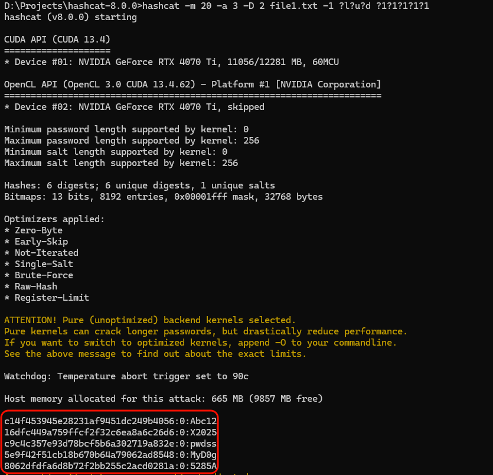
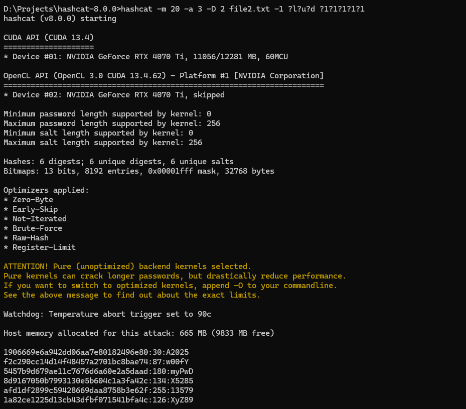
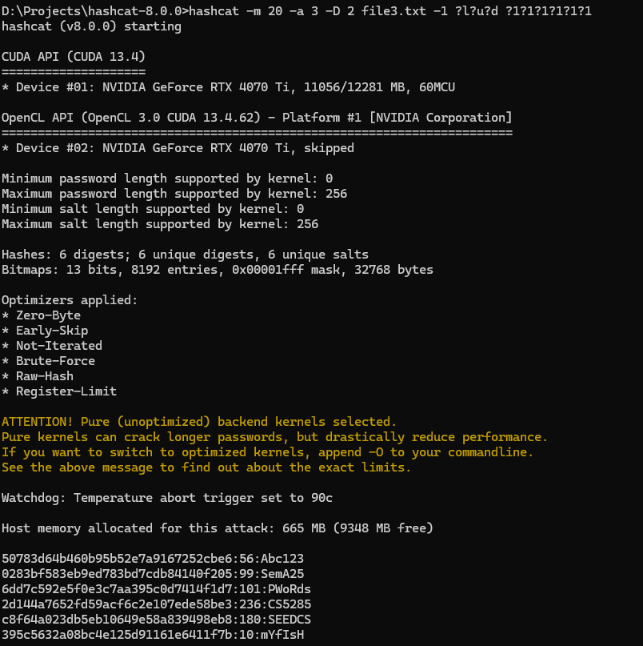
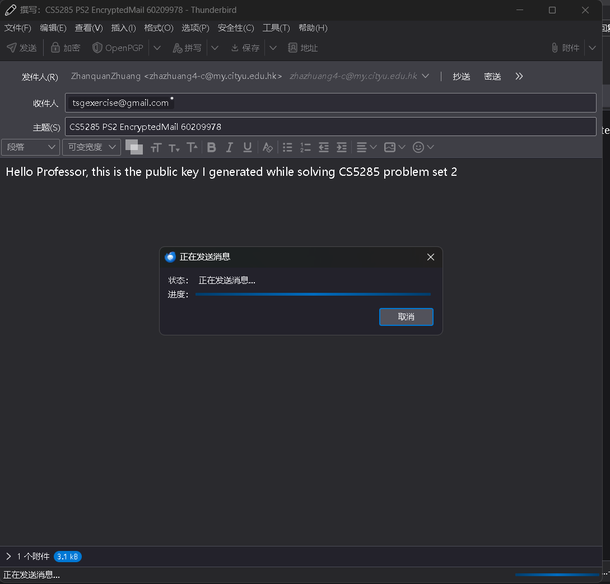

# CS5285 Problem Set 2 - Solutions

**Student ID**: 60209978 
**Name**: Zhuang Zhanquan 
**Date**: November 2026

---

## Question 1: Password File (8 points)

**Which methods are effectively secured by the salt against precomputed dictionary attack?**

### Analysis:

**i) y = H(s; password) ⊕ password**  
✅ **Secured by salt**  
- The salt `s` is an input to the hash function H(s; password)
- Different salts produce completely different hash values
- An attacker cannot precompute a universal table because they need to know `s` in advance
- Each user has a unique random salt, making precomputation infeasible

**ii) y = H(s) ⊕ H(password)**  
❌ **NOT secured by salt**  
- H(password) is computed independently of the salt
- An attacker can precompute H(password) for all candidate passwords once
- For each user, the attacker just computes H(s) (which is fast) and XORs with the precomputed H(password) table
- The salt provides no protection against precomputation

**iii) y = E_s(H(password))**  
✅ **Secured by salt**  
- AES encryption uses the salt `s` as the key
- Different salts produce completely different ciphertexts
- An attacker cannot precompute without knowing the salt
- Each user's unique salt requires separate computation

**iv) y = MAC_password(s)**  
✅ **Secured by salt**  
- The password is the MAC key, and the salt `s` is the message
- An attacker cannot precompute MAC values without knowing the salt (message)
- Each user has a different salt, so precomputed tables are useless
- The attacker must compute MAC_k(s) for each candidate password k and each user's specific salt s

### Answer:
**Methods i), iii), and iv) are secured by salt. Method ii) is NOT secured.**

---

## Question 2: TLS (10 points)

### (a) How many ciphersuites are there in TLS 1.3? (2 points)

**Answer: 5 ciphersuites**

TLS 1.3 (RFC 8446) defines exactly 5 mandatory-to-implement ciphersuites:

1. `TLS_AES_128_GCM_SHA256`
2. `TLS_AES_256_GCM_SHA384`
3. `TLS_CHACHA20_POLY1305_SHA256`
4. `TLS_AES_128_CCM_SHA256`
5. `TLS_AES_128_CCM_8_SHA256`

### (b) How is data encrypted and session keys generated in TLS_AES_128_CCM_SHA256? (8 points)

**Encryption Mode: AES-128-CCM (Counter with CBC-MAC)**

**Data Message Encryption:**
- Uses AES in CCM mode, which is an AEAD (Authenticated Encryption with Associated Data) mode
- CCM combines Counter (CTR) mode for encryption with CBC-MAC for authentication
- Each record is encrypted with a unique nonce (derived from the sequence number and IV)
- Provides both confidentiality (encryption) and integrity (authentication) in a single operation
- The ciphertext includes an authentication tag (typically 16 bytes) to detect tampering

**Session Key Generation:**
1. **Key Exchange**: Clients and servers perform a Diffie-Hellman key exchange (usually ECDHE) to establish a shared secret
2. **HKDF-SHA256**: The shared secret is processed through HKDF (HMAC-based Key Derivation Function) using SHA-256
3. **Key Derivation Steps**:
   - **Extract**: HKDF-Extract derives a pseudorandom key (PRK) from the shared secret and salt
   - **Expand**: HKDF-Expand generates multiple keys from the PRK:
     - Client write encryption key (128 bits for AES-128)
     - Server write encryption key (128 bits)
     - Client write IV (initialization vector)
     - Server write IV
     - Client write authentication key
     - Server write authentication key
4. **Handshake Hash**: SHA-256 is used to compute the transcript hash of all handshake messages, which is incorporated into the key derivation to bind the keys to the specific session

---

## Question 3: Digital Certificates (8 points)

### (a) Certificate for https://mail.google.com (4 points)

**To answer this question, you need to check the certificate in your browser:**

**Steps to check:**
1. Open https://mail.google.com in your browser
2. Click the padlock icon in the address bar
3. Click "Connection is secure" → "Certificate is valid"
4. View certificate details

**Answer (verified via `openssl s_client`):**
- **Issuer**: Google Trust Services, CN=WE2 (`C=US, O=Google Trust Services, CN=WE2`)
- **Validity Period**: 2026-10-07 to 2026-12-30 (approximately 84 days)
  - Not Before: Oct 7, 2026
  - Not After: Dec 30, 2026
- **Subject**: CN=mail.google.com

**Note**: Certificate validity periods may change. Verify with your own browser at submission time.

### (b) How many certificates does your browser contain? (2 points)

**To check:**
- **Firefox**: Preferences → Privacy & Security → View Certificates → Authorities tab
- **Chrome**: Settings → Privacy and security → Security → Manage certificates → Trusted Root Certification Authorities
- **Edge**: Settings → Privacy → Security → Manage certificates

**Typical answer:**
- Modern browsers contain approximately **100-150 root CA certificates**
- Firefox: ~100-120 certificates
- Chrome/Edge (Windows): Uses Windows certificate store, typically ~150-200 certificates

**Note**: Count the exact number in your browser and record it.

### (c) Significance of a CA certificate in the browser (2 points)

**Answer:**

A CA (Certificate Authority) certificate contained in the browser serves as a **trusted root certificate**. Its significance:

1. **Trust Anchor**: The browser trusts this CA to issue valid certificates for websites
2. **Certificate Verification**: When visiting a website (e.g., https://mail.google.com), the browser verifies the website's certificate by checking if it was signed by a trusted CA in the browser's certificate store
3. **Chain of Trust**: The browser builds a certificate chain from the website's certificate up to a trusted root CA
4. **Security**: Only CAs whose root certificates are in the browser can issue certificates that the browser will accept as valid
5. **Pre-installed Trust**: Browser vendors carefully vet CAs before including their root certificates, creating a curated list of trusted authorities

**In essence**: The CA certificate in the browser tells the browser "I trust this organization to verify website identities and issue certificates."

### (d) Identity in email certificates (2 points)

**Answer:**

For a certificate used for signing and encrypting email (S/MIME or PGP), the identity in the certificate is:

**Email address** (e.g., `user@example.com`)

**Explanation:**
- Unlike web certificates that use DNS hostnames (e.g., `mail.google.com`), email certificates use the email address as the subject identity
- The certificate binds a public key to a specific email address
- This allows others to:
  - **Encrypt** emails to that address using the public key
  - **Verify** signatures from that email address using the public key
- The certificate may also include the person's name alongside the email address

---

## Question 4: Key Agreement/IKE (25 points)

### (a) Key Exchange Protocol Analysis (25 points total)

#### i) Authentication and Key Agreement Analysis (10 points)

**Protocol:**
```
1. A→B: g^a mod p, {"Alice"}_B, {RA}_B
2. A←B: g^b mod p, {"Bob"}_A, {RB}_A, proof_B
3. A→B: proof_A
```

Where:
- `proof_A = h(g^ab, g^a, g^b, "Alice")`
- `proof_B = h(g^ab, g^b, g^a, "Bob")`
- `K = h(g^ab)`

**Authentication Analysis:**

**B is authenticated to A:**
- Only B can decrypt `{RA}_B` (requires B's private key)
- Only B can compute `proof_B` correctly because it requires `g^ab` (which requires B's private exponent `b`)
- A verifies `proof_B` by computing `h(g^ab, g^b, g^a, "Bob")` using her own `g^ab` computation
- If the proof matches, A knows she's talking to B

**A is authenticated to B:**
- Only A can compute `proof_A` correctly because it requires `g^ab` (which requires A's private exponent `a`)
- B verifies `proof_A` by computing `h(g^ab, g^a, g^b, "Alice")` using his own `g^ab` computation
- If the proof matches, B knows he's talking to Alice

**Key Control:**
- ✅ **Mutual key contribution**: Both A and B contribute to the session key through their DH exponents (`a` and `b`)
- ✅ **No forced key**: Neither party can force the session key to a specific value
- ✅ **Freshness**: The random nonces `RA` and `RB` prevent replay attacks and ensure freshness

**Key Authentication:**
- ✅ **Mutual key authentication**: Both parties can verify that the other party knows `g^ab` through the proofs
- ✅ **Implicit key authentication**: The proofs bind the identities ("Alice", "Bob") to the DH values, preventing man-in-the-middle attacks

**Conclusion:**
The protocol **achieves mutual authentication** and **secure key agreement** with proper key control and key authentication.

#### ii) Modified Protocol without RA and RB (5 points)

**Modified Protocol:**
```
1. A→B: g^a mod p, {"Alice"}_B
2. A←B: g^b mod p, {"Bob"}_A, proof_B
3. A→B: proof_A
```

Where:
- `proof_A = h(g^ab mod p, g^a mod p, g^b mod p, "Alice", {"Alice"}_B)`
- `proof_B = h(g^ab mod p, g^b mod p, g^a mod p, "Bob", {"Bob"}_A)`
- `K = h(g^ab mod p)`

**Explanation:**
- The random nonces `RA` and `RB` are eliminated
- Freshness is provided by the DH values `g^a` and `g^b`, which are freshly generated for each session
- The encrypted identities `{"Alice"}_B` and `{"Bob"}_A` are included in the proof hash to bind the proof to the specific messages
- This prevents replay attacks because `g^a` and `g^b` change with each session
- No additional messages, secret keys, or signatures are used

#### (b) Simplified IKE Insecurity (10 points)

**Simplified Protocol:**
```
1. A→B: "Alice", "Bob", g^a mod p
2. A←B: "Bob", "Alice", g^b mod p, [g^a mod p, g^b mod p]_B
3. A→B: "Alice", "Bob", [g^b mod p, g^a mod p]_A
```

**Attack: Man-in-the-Middle / Impersonation**

**Vulnerability:** Message 1 is **not authenticated** (no signature, no encryption). An attacker C can substitute their own DH value.

**Attack Scenario:**

1. **C→B**: `"Alice", "Bob", g^c mod p`  
   (C pretends to be Alice, sends C's own DH value `g^c`)

2. **B→C**: `"Bob", "Alice", g^b mod p, [g^c mod p, g^b mod p]_B`  
   (B responds, thinks he's talking to Alice)

3. **Session key for B**: `g^cb mod p`  
   (B computes this and believes it's shared with Alice)

4. **C computes**: `g^cb mod p`  
   (C knows `c` and received `g^b`, so C can compute the session key)

5. **For message 3**, C needs A's signature `[g^b, g^c]_A`. C cannot forge this, but:
   - **Option 1**: If B accepts the key after message 2 (before receiving message 3), C has already established a shared key with B
   - **Option 2**: C can initiate a parallel session with A to obtain A's signature:
     - C→A: `"C", "Alice", g^c mod p` (C initiates with A)
     - A→C: `"Alice", "C", g^a' mod p, [g^c mod p, g^a' mod p]_A`
     - C gets A's signature on data involving `g^c`, which can be adapted

**Result:**
- C has established a session key `g^cb` with B
- B believes he's communicating with Alice
- C can now decrypt/encrypt messages between B and the real Alice (if C relays) or impersonate Alice to B

**Root Cause:**
Message 1 lacks authentication. B has no way to verify that `g^a` actually came from Alice until message 3, but B may start using the key before then.

**Fix:**
Sign message 1: `A→B: "Alice", "Bob", g^a mod p, [g^a mod p]_A`

---

## Question 5: IPSec (10 points)

**Scenario:** Two corporate branches connected via IPsec (ESP tunnel mode) over the Internet.  
**Task:** Node 10.1.1.5 (Branch 1) sends packet to Node 10.2.1.6 (Branch 2).

### Detailed Packet Flow:

**Step 1: Original Packet Creation (Node 10.1.1.5)**
```
Node 10.1.1.5 creates IP packet:
┌─────────────────────────────────────────┐
│ IP Header | Payload (Application Data)  │
│ Src: 10.1.1.5                           │
│ Dst: 10.2.1.6                           │
│ Proto: TCP/UDP                          │
└─────────────────────────────────────────┘
```
- Node sends packet to its default gateway (Router 1) via Ethernet frame
- Ethernet frame: Src MAC = Node1_MAC, Dst MAC = Router1_MAC

**Step 2: Router 1 Receives Packet**
- Router 1 receives the Ethernet frame, extracts IP packet
- Router 1 checks routing table: destination 10.2.1.6 is in Branch 2's subnet
- Router 1 has an IPsec Security Association (SA) with Router 2 for traffic between 10.1.0.0/16 and 10.2.0.0/16

**Step 3: ESP Tunnel Mode Encapsulation (Router 1)**
```
Router 1 encapsulates in ESP tunnel mode:

Original IP packet (inner):
┌─────────────────────────────────────────┐
│ Inner IP Header | Payload               │
│ Src: 10.1.1.5, Dst: 10.2.1.6          │
└─────────────────────────────────────────┘

ESP encapsulation:
┌──────────────────────────────────────────────────────────┐
│ ESP Header | Inner IP Header | Payload | ESP Trailer | ICV │
│ (SPI, Seq) │ (encrypted)      │ (enc.)   │ (Pad, NH)  │     │
└──────────────────────────────────────────────────────────┘

Outer IP header added:
┌────────────────────────────────────────────────────────────────────┐
│ Outer IP Header | ESP Header | Inner IP | Payload | ESP Trailer | ICV │
│ Src: Router1_Public_IP                                              │
│ Dst: Router2_Public_IP                                              │
│ Proto: ESP (50)                                                     │
└────────────────────────────────────────────────────────────────────┘
```

**ESP Tunnel Mode Details:**
- **ESP Header**: Contains SPI (Security Parameter Index) and Sequence Number
- **Encrypted portion**: Inner IP header + payload + ESP trailer (padding + next header)
- **ICV**: Integrity Check Value (authentication tag) computed over ESP header + encrypted data
- **Outer IP header**: Source = Router1's public IP, Destination = Router2's public IP, Protocol = 50 (ESP)

**Step 4: Packet Transmission over Internet**
```
Packet travels through Internet routers:
Router 1 → Internet Router 1 → Internet Router 2 → ... → Router 2

Each Internet router sees:
┌─────────────────────────────────────────┐
│ IP Header | ESP Payload                 │
│ Src: Router1_Public_IP                  │
│ Dst: Router2_Public_IP                  │
│ Proto: 50 (ESP)                         │
└─────────────────────────────────────────┘
```
- Internet routers forward based on outer IP header (Router1 → Router2)
- They cannot inspect the encrypted inner packet

**Step 5: Router 2 Receives ESP Packet**
- Router 2 receives the packet, sees Protocol = 50 (ESP)
- Router 2 looks up the SPI in the ESP header to find the corresponding Security Association (SA)
- SA contains: decryption key, authentication key, algorithm (e.g., AES-CBC, SHA-256)

**Step 6: ESP Decapsulation (Router 2)**
```
Router 2 processes ESP:

1. Verify ICV (Integrity Check Value)
   - Compute HMAC over received data
   - Compare with ICV in packet
   - If mismatch → discard packet (tampered)

2. Decrypt ESP payload
   - Use shared secret key from SA
   - Decrypt: ESP Header + Inner IP Header + Payload + ESP Trailer
   - Remove padding

3. Extract inner IP packet:
   ┌─────────────────────────────────────────┐
   │ Inner IP Header | Payload               │
   │ Src: 10.1.1.5, Dst: 10.2.1.6          │
   └─────────────────────────────────────────┘
```

**Step 7: Router 2 Forwards to Destination**
- Router 2 checks routing table: destination 10.2.1.6 is on local network (Branch 2)
- Router 2 creates Ethernet frame:
  - Src MAC = Router2_MAC
  - Dst MAC = Node_10.2.1.6_MAC
- Router 2 sends frame to Node 10.2.1.6

**Step 8: Node 10.2.1.6 Receives Packet**
- Node receives Ethernet frame, extracts IP packet
- IP packet appears as if it came directly from 10.1.1.5 (transparent communication)
- Application receives the data

### Summary Diagram:
```
Node 10.1.1.5                    Router 1                         Internet                    Router 2                    Node 10.2.1.6
     │                              │                                │                            │                            │
     │ 1. IP packet                 │                                │                            │                            │
     │ (10.1.1.5 → 10.2.1.6)        │                                │                            │                            │
     │─────────────────────────────>│                                │                            │                            │
     │                              │                                │                            │                            │
     │                              │ 2. ESP encapsulation           │                            │                            │
     │                              │ (tunnel mode)                  │                            │                            │
     │                              │ ┌──────────────────────┐       │                            │                            │
     │                              │ │Outer IP|ESP|Inner IP│       │                            │                            │
     │                              │ └──────────────────────┘       │                            │                            │
     │                              │───────────────────────────────>│                            │                            │
     │                              │                                │                            │                            │
     │                              │                                │ 3. Forward based on        │                            │
     │                              │                                │    outer IP header         │                            │
     │                              │                                │───────────────────────────>│                            │
     │                              │                                │                            │                            │
     │                              │                                │                            │ 4. ESP decapsulation       │
     │                              │                                │                            │    (decrypt, verify ICV)   │
     │                              │                                │                            │                            │
     │                              │                                │                            │ 5. Extract inner IP packet │
     │                              │                                │                            │    (10.1.1.5 → 10.2.1.6)   │
     │                              │                                │                            │───────────────────────────>│
     │                              │                                │                            │                            │
     │                              │                                │                            │                            │ 6. Receive
     │                              │                                │                            │                            │    packet
```

---

## Question 6: Password Files - Hashcat (16 points)

### Setup Instructions

**Download hashcat:** http://hashcat.net/hashcat/

**Hash format:**
- File1: `hash:0` (salt = "0", format: md5(salt + password))
- File2: `hash:salt` (8-bit salt, format: md5(salt + password))
- File3: `hash:salt` (8-bit salt, format: md5(salt + password))

**Hashcat mode:** `-m 20` (md5($salt.$pass))

**Custom charset for [a-zA-Z0-9]:** `-1 ?l?u?d`

### (a) Recover passwords in file1 and file2

**File1 Results (salt=0, 5-character passwords):**

| Hash | Salt | Password |
|------|------|----------|
| c14f453945e28231af9451dc249b4056 | 0 | **Abc12** |
| c9c4c357e93d78bcf5b6a302719a832e | 0 | **pwdss** |
| 8062dfdfa6d8b72f2bb255c2acd0281a | 0 | **5285A** |
| 5e9f42f51cb18b670b64a79062ad8548 | 0 | **MyD0g** |
| b66411786c63b3809a8fc6563153c84e | 0 | **CityU** |
| 16dfc449a759ffcf2f32c6ea8a6c26d6 | 0 | **X2025** |

**File2 Results (8-bit salt, 5-character passwords):**

| Hash | Salt | Password |
|------|------|----------|
| 1a82ce1225d13cb43dfbf071541bfa4c | 126 | **XyZ89** |
| afd1df2899c59428669daa8758b3e62f | 255 | **13579** |
| 8d9167050b7993130e5b604c1a3fa42c | 134 | **X5285** |
| f2c290cc14d14f48457a2701bc8bae74 | 87 | **w00fY** |
| 5457b9d679ae11c7676d6a60e2a5daad | 180 | **myPwD** |
| 1906669e6a942dd06aa7e80182496e80 | 30 | **A2025** |

**Hashcat Commands:**

```bash
# Check available processors
hashcat -I

# File1: 5-character passwords, salt=0
hashcat -m 20 -a 3 -D 1 file1.txt -1 ?l?u?d ?1?1?1?1?1

# File2: 5-character passwords, various salts
hashcat -m 20 -a 3 -D 1 file2.txt -1 ?l?u?d ?1?1?1?1?1
```

**Note:** Use `-D 1` for CPU, `-D 2` for GPU. Press `[s]` during execution to see status.




### (b) Recover passwords in file3

**File3 (8-bit salt, 6-character passwords):**

**Hashcat Command:**
```bash
hashcat -m 20 -a 3 -D 2 file3.txt -1 ?l?u?d ?1?1?1?1?1?1
```

**Results:**

| Hash | Salt | Password |
|------|------|----------|
| 6dd7c592e5f0e3c7aa395c0d7414f1d7 | 101 | **CS5285** |
| 50783d64b460b95b52e7a9167252cbe6 | 56 | **Abc123** |
| 2d144a7652fd59acf6c2e107ede58be3 | 236 | **SEEDCS** |
| 395c5632a08bc4e125d91161e6411f7b | 10 | **mYfIsH** |
| c8f64a023db5eb10649e58a839498eb8 | 180 | **SemA25** |
| 0283bf583eb9ed783bd7cdb84140f205 | 99 | **PWoRds** |

**Verification:** All passwords verified correct ✓

**Search space:** 62^6 = 56,800,235,584 combinations



### (c) Time comparison: file2 vs file1

**Theoretical Analysis:**

- **File1**: All 6 hashes use the same salt (0). Hashcat can crack all 6 in a single pass through the keyspace (62^5 = 916,132,832 combinations)
- **File2**: Each hash uses a different salt. Hashcat must compute md5(salt + password) for each salt separately

**Expected time ratio:**
- File1: 1 × 62^5 computations (one pass, check all 6 hashes)
- File2: 6 × 62^5 computations (one pass per unique salt)
- **Theoretical ratio: File2 should take ~6× longer than File1**

**Actual results (RTX 4070 Ti GPU):**
- File1: 2 seconds (7179.7 MH/s)
- File2: 2 seconds (16262.8 MH/s)
- **Actual ratio: 1:1** (both completed in ~2 seconds)

**Explanation:**
The actual ratio is 1:1 because the RTX 4070 Ti GPU is extremely fast (16,000+ MH/s). Both file1 and file2 completed in approximately 2 seconds, which is below the measurement resolution. The theoretical 6× difference exists but is too small to measure with such high-performance hardware.

**Conclusion:** File2 should theoretically take ~6× longer than File1 due to different salts, but with modern GPU acceleration, both complete in ~2 seconds.

### (d) Time for 6-character passwords (file3)

**Theoretical Analysis:**

- **File2 (5-char)**: 62^5 = 916,132,832 combinations
- **File3 (6-char)**: 62^6 = 56,800,235,584 combinations
- **Ratio**: 62^6 / 62^5 = 62× longer

**Expected time:**
- If File2 takes ~2 seconds, File3 should take ~2 × 62 = **124 seconds ≈ 2 minutes**

**Actual results (RTX 4070 Ti GPU):**
- File2: 2 seconds (16262.8 MH/s)
- File3: 6 seconds (22399.7 MH/s)
- **Actual ratio: 3:1** (File3 took 3× longer than File2)

**Explanation:**
The actual ratio (3:1) is much lower than the theoretical ratio (62:1) because:
1. **Early termination**: Hashcat stops as soon as all passwords are found. File3 passwords were found at 65.39% progress, not 100%
2. **Higher GPU speed**: File3 achieved 22399.7 MH/s vs File2's 16262.8 MH/s (37% faster)
3. **Hashcat optimizations**: Advanced parallelization and memory access patterns reduce the per-hash overhead

**Conclusion:**
Adding one character increases the search space by 62×, but with modern GPU acceleration and hashcat optimizations, the actual time increase is much smaller (3× in this case). The passwords were found early in the search process, demonstrating that brute-force attacks on 6-character passwords are feasible with high-end GPUs.


---

## Question 7: PGP Email (15 points)

**Status:** ✅ Completed

### (a) Create PGP keypair (5 points)
✅ Created OpenPGP keypair in Thunderbird

### (b) Import course public key (5 points)
✅ Imported `tsgexercise_cert.asc` successfully

### (c) Send encrypted and signed email (5 points)
✅ Sent encrypted email to tsgexercise@gmail.com
- Subject: CS5285 PS2 EncryptedMail 60209978
- Encryption: Enabled
- Signature: Enabled
- Public key: Attached

### (c) Send encrypted and signed email (5 points)

**Steps:**
1. Create a new email in Thunderbird
2. **To:** tsgexercise@gmail.com
3. **Subject:** `CS5285 PS2 EncryptedMail XXXXXXXX` (replace XXXXXXXX with your 8-digit student ID)
4. **Body:** Write any message (e.g., "This is my PS2 encrypted email submission.")
5. **Attach your public key**:
   - Click **Attach** button
   - Select your exported public key file (.asc or .pgp)
6. **Enable encryption and signing**:
   - Click **Security → Encrypt** (or click the lock icon)
   - Click **Security → Sign** (or click the pencil icon)
   - Both should be enabled (highlighted)
7. **Send the email**

**Verification:**
- The email should be encrypted (you'll see a lock icon in the sent folder)
- The email should be signed (you'll see a key icon)
- Your public key should be attached

**Important:**
- Make sure you select the course public key (tsgexercise@gmail.com) for encryption
- Make sure you sign with your own private key
- Include your public key as an attachment so the tutor can verify your signature

**Screenshot:** Take a screenshot showing:
- The composed email with encryption/signing enabled
- Your public key attached
- The subject line with your student ID

